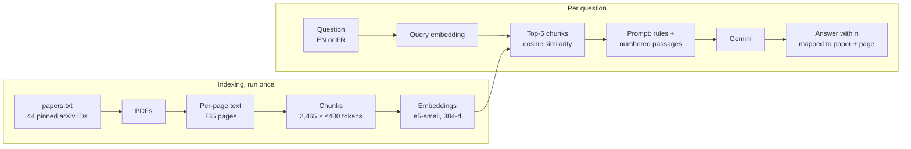

# arxiv-rag

Question answering over 44 arXiv papers on adversarial machine learning, with citations to the exact paper and page, and an explicit refusal when the answer is not in the corpus.

Every design choice below was measured on a hand-checked evaluation set, and the README reports where the system fails as well as where it works.

## Why: an LLM alone cannot be used as a source

Before building anything, Gemini was asked for 5 well-known and 5 niche papers on universal adversarial perturbations, and every reference was checked on arXiv ([`results/exp00_llm_references.md`](results/exp00_llm_references.md)).

| Topic | Fully correct references |
|---|---|
| Well-known (universal adversarial perturbations) | 3 / 5 |
| Niche (perturbations in the latent space of the Stable Diffusion VAE) | 1 / 5 |

No paper was invented outright. The errors were subtler and harder to spot: an arXiv ID one digit off, a first author borrowed from the next reference in the same list, a rewritten title, and descriptions that contradict the papers' own abstracts. All of them looked plausible.

This system answers only from retrieved passages, and the code (not the LLM) turns each citation into a paper, a page and a link.

## How it works



| Stage | Choice | Reason |
|---|---|---|
| Corpus | 44 papers, each arXiv ID pinned to a version (`corpus/papers.txt`) | A citation to "page 4" must stay valid; PDFs are downloaded by script, never redistributed |
| Extraction | PyMuPDF, page by page; ligatures expanded, end-of-line hyphenation rejoined | Keeps the page number of every passage |
| Chunking | ≤400 tokens counted with the embedding model's own tokenizer, 80-token overlap, never across pages | A word-based first version silently truncated 335 chunks (15%) at the model's 512-token limit; the token-based version truncates 0 |
| Embeddings | `intfloat/multilingual-e5-small`, paper title prepended to each chunk | Multilingual (French questions on English papers); title prefix matched the larger e5-base at a third of the compute (see below) |
| Vector store | NumPy matrix, one matrix product per query | 2,465 vectors do not need an approximate index |
| Generation | `gemini-3.5-flash`, low thinking level, rules in the system instruction | The model must cite `[n]` after every claim and reply `NOT_FOUND` when the passages do not contain the answer |
| Citations | Parsed from the answer and mapped to paper, page and arXiv link by the code | The LLM never writes a title or page number; citations to passages that were not provided are flagged |

## Evaluation set

[`eval/questions.jsonl`](eval/questions.jsonl): 30 questions written from the text of four papers (UAP, Fast-UAP, FGSM, DeepFool) and spot-checked against the PDFs.

- 25 answerable questions, each labelled with the paper and page that contain the answer
- 5 unanswerable questions (traps), e.g. *"Which paper crafts a universal perturbation directly in the latent space of the Stable Diffusion VAE?"*
- 5 questions in French

Retrieval is searched over all 2,465 chunks of the 44 papers, so the other 40 papers act as distractors.

## Results

### Retrieval (25 answerable questions)

A hit means a retrieved chunk comes from the labelled page.

| Experiment | Embedding model | recall@1 | recall@3 | recall@5 | recall@10 | MRR | recall@5 (FR, 4 q.) | Encoding time, laptop CPU |
|---|---|---|---|---|---|---|---|---|
| exp01 | e5-small | 0.52 | 0.68 | 0.76 | 0.84 | 0.63 | 0.50 | ~9 min |
| exp02 | e5-base | 0.56 | 0.72 | 0.80 | 0.92 | 0.67 | 0.75 | ~28 min |
| **exp03** | **e5-small + title prefix** | 0.48 | 0.68 | **0.80** | **0.92** | 0.62 | 0.75 | ~14 min |

With 25 questions, one question is 4 points: the differences between these three runs are within noise. exp03 is kept because it reaches e5-base's recall@5 and recall@10 with a model three times smaller, which matters for deployment. The title prefix fixed the question it targeted (q001, a page that never names its own paper: not retrieved → rank 5).

### End to end (exp04, 30 questions)

| Metric | Result |
|---|---|
| Unanswerable questions correctly refused | **5 / 5** |
| Answerable questions answered correctly | **19 / 25** |
| Answers citing the labelled page | 18 / 25 |
| Citations to passages that were not provided | 0 |
| Mean tokens per question | ~2,200 |

Correctness is judged by a second model (`gemini-3.1-flash-lite`) against the reference answer; every verdict and its reason are in [`results/exp04_generation_details.jsonl`](results/exp04_generation_details.jsonl).

Where the six failures come from:

| Labelled page in the 5 passages given to the LLM? | Questions | Outcome |
|---|---|---|
| Yes (20) | 18 | Correct, cited answer |
| | 2 (q017, q020) | Refused |
| No (5) | 4 | Refused |
| | 1 (q013) | Answered, judged correct |

The system never answered a trap question, and refused 4 of the 5 questions whose evidence was not retrieved. Most failures are retrieval failures turned into refusals rather than invented answers.

The two refusals with the "right page" retrieved are a measurement artefact, confirmed for q017: page 5 of the FGSM paper is split into three chunks, the answer ("fell to 17.9%") is in chunk `p5_c2`, and only chunks `c0` and `c1` were retrieved. The model was right to refuse. Page-level relevance therefore **overestimates** retrieval quality.

## Limitations

- **Small evaluation set.** 30 questions drawn from 4 of the 44 papers; only 5 in French. Differences of one or two questions are not significant.
- **Page-level relevance labels** overestimate recall (q017 above). Labelling an exact evidence string per question and checking it against the retrieved chunks would measure retrieval at chunk level.
- **Single runs.** The LLM does not give the same answer twice; each configuration was run once.
- **LLM-as-judge.** Correctness is decided by another LLM, spot-checked but not fully reviewed by hand.
- **PDF extraction.** Formulas are flattened (`k̂(x+v) ≠ k̂(x)` becomes `ˆk(x + v)̸ = ˆk(x)`), and a line overlapping an algorithm box was dropped on one page. Questions about the exact form of an equation are likely to fail.
- **Chunks never cross pages**, so an idea split by a page break is split in two chunks.
- **Free tier.** The Gemini free tier allows 20 requests per day per model, which bounds both the evaluation (exp04 ran over two days, resuming where it stopped) and any public demo. Prompts sent on the free tier may be used by Google to improve its products: only public papers are sent.

## Reproduce

Windows PowerShell, Python 3.12.

```powershell
python -m venv .venv
.\.venv\Scripts\Activate.ps1
pip install -r requirements.txt
```

Create a `.env` file at the root (it is git-ignored):

```
GEMINI_API_KEY=your_key
```

A free key is available from Google AI Studio.

```powershell
python src/fetch_corpus.py                                  # check IDs on arXiv, download the 44 pinned PDFs
python src/extract_text.py                                  # data/pages.jsonl
python src/chunk.py                                         # data/chunks.jsonl
python src/embed.py intfloat/multilingual-e5-small --titles # data/embeddings.npy
python src/eval_retrieval.py exp03_e5_small_titles          # retrieval metrics
python src/eval_generation.py exp04_generation              # end-to-end metrics (resumable)
```

Ask a question:

```powershell
python src/answer.py "Why does Fast-UAP reject the l2 constraint for its universal perturbations?"
```

## Repository layout

```
corpus/papers.txt         44 pinned arXiv IDs
eval/questions.jsonl      evaluation set
results/                  one file per experiment (exp00 to exp04)
src/
  fetch_corpus.py         arXiv metadata check and PDF download
  extract_text.py         per-page text extraction and cleaning
  inspect_pdf.py          print the extracted text of one page
  chunk.py                token-bounded, page-bounded chunking
  embed.py                chunk embeddings
  search.py               dense retrieval
  answer.py               retrieval + generation + citation mapping
  eval_retrieval.py       recall@k and MRR
  eval_generation.py      refusals, citations and correctness
exploration/              first API calls and the exp00 script
```
