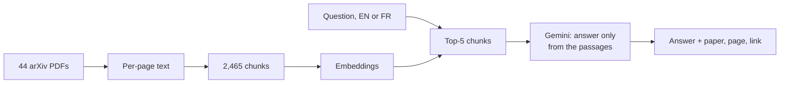
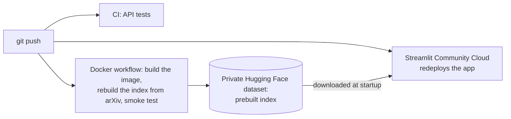

# adversarial-attacks-rag
[](https://github.com/AYMANE-SNOUSSI/adversarial-attacks-rag/actions/workflows/ci.yml)
[](https://github.com/AYMANE-SNOUSSI/adversarial-attacks-rag/actions/workflows/docker.yml)

**Live demo: [adversarial-attacks-rag.streamlit.app](https://adversarial-attacks-rag.streamlit.app)**

Ask questions about 44 research papers on adversarial attacks in computer vision, in English or French. Every answer cites the paper and page it comes from, and the system says so when the answer is not in the papers.

```
> python src/answer.py "How many training images are used to compute a universal perturbation in Moosavi-Dezfooli et al.?"

The universal perturbations are computed using a set of 10,000 images from the training set [2].
This averages out to 10 images per class [2].

[2] Universal adversarial perturbations, page 4 - https://arxiv.org/abs/1610.08401v3
```

```
> python src/answer.py "Which paper crafts a universal perturbation directly in the latent space of the Stable Diffusion VAE?"

No answer in the corpus: the retrieved passages do not contain it.
```

## Why

Asked for references on the same topic without retrieval, Gemini returned only 4 fully correct out of 10: wrong arXiv IDs, an author borrowed from another paper, rewritten titles. They all looked plausible. ([experiment](results/exp00_llm_references.md))

## Results

On 30 questions checked against the papers, including 5 trap questions whose answer is not in the corpus:

| | |
|---|---|
| Trap questions refused | **5 / 5** |
| Correct, cited answers | **19 / 25** |
| Correct when the relevant page was retrieved | **18 / 20** |
| Citations to passages that were not provided | **0** |

When retrieval misses the evidence, the system refuses instead of guessing: most failures are refusals, not wrong answers.

## How it works



The same engine (`src/engine.py`) serves a FastAPI endpoint (`POST /ask`) and the Streamlit interface.

PyMuPDF · `multilingual-e5-small` · NumPy · Gemini 3.5 Flash (free tier) · FastAPI · Streamlit · Docker · GitHub Actions

## Deployment



The paper text is never committed: the index is rebuilt from arXiv in CI and stored in a private dataset that only the app can read.

## Run it

```powershell
python -m venv .venv
.\.venv\Scripts\Activate.ps1
pip install -r requirements.txt
```

Add a `.env` file with `GEMINI_API_KEY=your_key` (free key from Google AI Studio), then build the index:

```powershell
python src/fetch_corpus.py
python src/extract_text.py
python src/chunk.py
python src/embed.py intfloat/multilingual-e5-small --titles
```

Then use it from the command line, the web interface or the API:

```powershell
python src/answer.py "your question"
streamlit run src/app.py
uvicorn api:app --app-dir src
```

Or with Docker, which builds the index inside the image: `docker compose up --build`, then open http://localhost:8501.

Tests: `pytest`.

## Limitations

- Small evaluation set: 30 questions from 4 of the 44 papers.
- Formulas are poorly extracted from PDFs, so questions about the exact form of an equation tend to fail.
- French answers sometimes keep an English term or use an awkward translation of a technical word.
- The Gemini free tier allows 20 requests per day per model (two models are used in turn).
- The demo sleeps after 12 hours without visits and takes 1 to 2 minutes to wake up.

Design choices, all experiments and the analysis of every failure: [docs/evaluation.md](docs/evaluation.md).